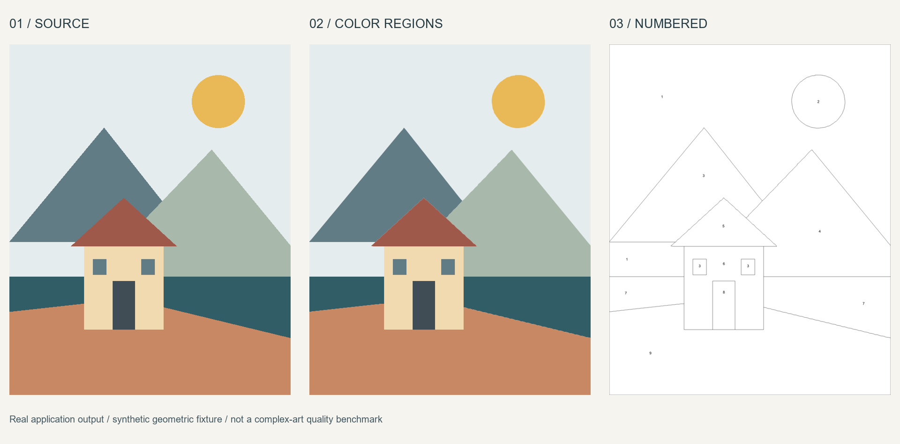
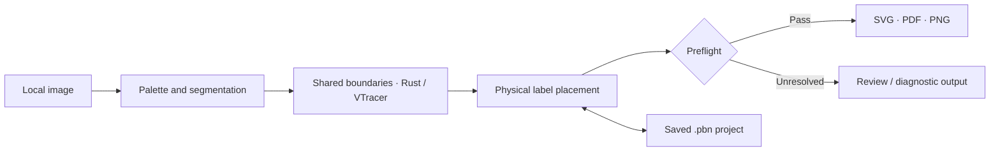

# PBN Studio

### Turn an image into a paint-by-numbers project. Keep the work on your own machine.

PBN Studio is a local Windows desktop application for preparing paint-by-numbers pages: reduce an image to a palette, trace regions, place labels, and export a printable set. The interface uses Python/PySide6; a separate native Rust worker uses pinned [VTracer](https://github.com/visioncortex/vtracer) sources.

[Русский](README.ru.md) · [Build from source](docs/build.md) · [Roadmap](docs/ROADMAP.md) · [Contribute](CONTRIBUTING.md) · [Issues](https://github.com/sergkreis/pbn-studio/issues)

> **Early developer preview, based on 0.2.1-rc.2.** The pipeline exists, but visual quality is still unresolved. Fine details can disappear, smooth boundaries can fail validation, and labels do not always fit. This is a project to improve together, not a promise of production-ready coloring pages.

## A look at the pipeline



A generated example, not a desktop screenshot or a claim of general visual quality. No user artwork or commercial book pages are used for this preview.



## What works, and what needs help

“Implemented” below describes code paths, not acceptance on every image or printer.

| Area | Implemented today | Still needs work |
|---|---|---|
| Local processing | Raster input, configurable palette size, speckle filtering and simplification; no cloud processing service required | Preserving thin strokes, small features and close colors |
| Region geometry | Native segmentation and shared-boundary tracing; smooth-geometry checks | Topology-preserving smoothing; exact pixel boundaries remain an explicit, stepped fallback |
| Page and labels | Physical page sizes, margins, line widths and adaptive numeric label sizes with a minimum readable size | Better glyph placement in narrow regions; a one-character label mode is not implemented |
| Preview | Source/result views, palette, color/contour/number views, zoom and pan | Responsiveness on large jobs; the current interface is in Russian |
| Projects | Save/reopen `.pbn` projects with the source image and document state; `.pbnx` is also recognized | Broader round-trip coverage; manual editing controls are currently hidden |
| Export | Answer, numbered page and palette in SVG/PDF/PNG; vector rendering for SVG/PDF, 150 dpi for PNG | Real print acceptance; unresolved preflight issues block normal export |
| Batch jobs | Multiple inputs, per-item results and cooperative cancellation | Performance and cancellation responsiveness; stopping is not instantaneous |
| Builds and tests | Source build scripts, automated tests and native export smoke checks | Clean-machine and reproducible builds; some legacy tests need fixtures absent from this public snapshot |

Diagnostic exports are explicitly **not for printing**. A passing preflight is not a substitute for inspecting the image and a physical print.

## Try it from source

The initial public publication is source-only. Windows x64 is the development target; other platforms are not validated. Python `>=3.11,<3.14` is required. The UI currently uses Russian text and label rendering uses the system Arial font.

1. Download the source from [this repository](https://github.com/sergkreis/pbn-studio).
2. Follow [docs/build.md](docs/build.md) to create a Python environment, install dependencies and build the Rust worker from the same checkout.
3. From the repository root, launch the application in PowerShell:

   ```powershell
   & ./.venv/Scripts/python.exe launch.py
   ```

Installing Python dependencies alone does **not** build `assets/worker/pbn_worker.exe`. See the build guide for the native toolchain and packaging steps; do not substitute a binary from an unrelated checkout.

### First project

1. Open a raster image you have permission to use. Keep the original separately.
2. Choose the palette size and detail settings, then build the page.
3. Compare the source with the result before changing print settings. Small features matter more than a low issue count.
4. Set the intended page size, margins, label size and line width. Review preflight issues. Print simplification changes regions and asks for confirmation.
5. Save a project, then export when the issues are resolved. Use a diagnostic export only to investigate a blocked result.

Do not enlarge the page or erase meaningful details just to make validation pass.

## Help make the pages better

The most useful contributions are in [the roadmap](docs/ROADMAP.md): segmentation preservation, topology-safe smoothing, adaptive glyph placement, one-character labels, reproducible builds and UI performance. Small reproductions and careful before/after comparisons are welcome, even without a code change.

[GitHub pull requests](https://github.com/sergkreis/pbn-studio/pulls) are accepted. Start with [CONTRIBUTING.md](CONTRIBUTING.md) for review expectations and safe test fixtures.

Historical RC2 validation reported **326 passed, 1 skipped** in an older local environment. That is not a result for a clean public checkout or GitHub CI. Read [testing](docs/testing.md) and [known limitations](docs/known-issues.md), and consult actual workflow runs for remote status. A workflow file is not evidence of a passing run.

## Inside the repository

| Path | Purpose |
|---|---|
| `pbnstudio/`, `launch.py` | PySide6 application, document model, labels, storage and export |
| `native/worker/` | Rust worker adapter |
| `vendor/vtracer/` | Pinned upstream tracing source and dependency lockfile |
| `build/` | Worker and Windows packaging scripts |
| `tests/`, `tests_engine/` | Application and native integration tests |
| `examples/`, `docs/` | Public examples, build instructions and contributor documentation |

This public repository begins with a source snapshot. Private development history is retained separately and is not mirrored here. See [provenance](docs/PROVENANCE.md).

## Your images stay yours

Processing runs locally. Saved projects contain the source image; projects and diagnostic files can expose private data if you share them. Do not attach user artwork, paid book pages, private projects or raw logs to issues and pull requests. Use a small synthetic reproduction instead. See [SECURITY.md](SECURITY.md).

## License

Original PBN Studio code is licensed under **GNU GPL version 3 only (`GPL-3.0-only`)**. See [LICENSE](LICENSE). Third-party components retain their own licenses; see [THIRD_PARTY_NOTICES.md](THIRD_PARTY_NOTICES.md).

**Using PBN Studio does not place your input artwork or generated output under the GPL.** Rights and restrictions attached to your source material still apply. Only use and share artwork you have permission to use.
