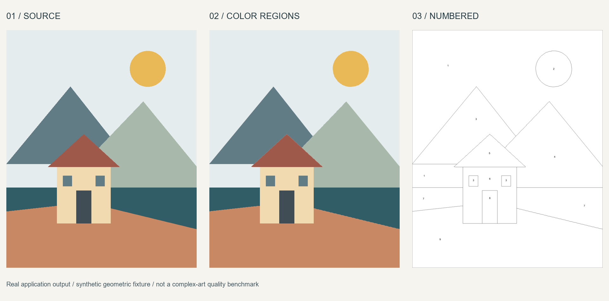
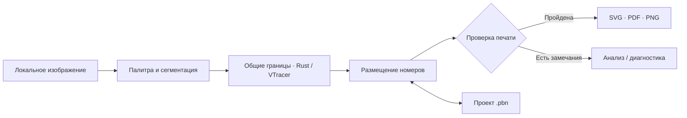

# PBN Studio

### Из изображения — в раскраску по номерам. Обработка на вашем компьютере.

PBN Studio — локальное Windows-приложение для подготовки раскрасок по номерам: палитра, области, контуры, номера и комплект для печати. Интерфейс написан на Python/PySide6; отдельный native worker на Rust использует закреплённые исходники [VTracer](https://github.com/visioncortex/vtracer).

[English](README.md) · [Сборка](docs/build.md) · [План развития](docs/ROADMAP.md) · [Участие](CONTRIBUTING.md) · [Задачи](https://github.com/sergkreis/pbn-studio/issues)

> **Ранний developer preview на основе 0.2.1-rc.2.** Конвейер работает, но задача визуального качества ещё не решена. Мелкие детали могут исчезать, гладкие границы — не проходить проверку, номера — не помещаться. Это приглашение к совместной разработке, а не обещание готовых к тиражированию страниц.

## От исходника к странице



Это сгенерированный пример, не скриншот интерфейса и не доказательство качества на любых изображениях. Для превью не используются пользовательские иллюстрации или страницы коммерческих книг.



## Что уже есть, а где нужна помощь

Наличие функции в коде не означает, что она принята на всех изображениях и принтерах.

| Область | Реализовано | Требует доработки |
|---|---|---|
| Локальная обработка | Растровый вход, настройка палитры, фильтрация мелких областей и упрощение; облачный сервис не нужен | Сохранение тонких линий, мелких деталей и близких цветов |
| Геометрия | Native-сегментация, общие границы областей, проверки гладких контуров | Сглаживание с сохранением топологии; точные пиксельные границы остаются отдельным ступенчатым запасным режимом |
| Страница и номера | Физические размеры страницы, поля, толщина линии, адаптивные числовые метки с нижней границей размера | Размещение в узких областях; односимвольный режим пока не реализован |
| Просмотр | Исходник и результат, палитра, цвет, контуры, номера, масштаб и перемещение | Отзывчивость на больших заданиях; интерфейс пока на русском |
| Проекты | Сохранение и открытие `.pbn` с исходником и состоянием документа; распознаётся `.pbnx` | Более широкие проверки сохранения/открытия; ручные инструменты сейчас скрыты |
| Экспорт | Ответ, страница с номерами и палитра в SVG/PDF/PNG; векторный рендеринг SVG/PDF, PNG в 150 dpi | Приёмка реальной печати; нерешённые замечания блокируют обычный экспорт |
| Пакетная обработка | Несколько файлов, результат по каждому, кооперативная отмена | Скорость и отзывчивость отмены; мгновенная остановка не гарантируется |
| Сборки и тесты | Скрипты сборки, автоматические тесты и smoke-проверки native-экспорта | Чистая Windows, воспроизводимость; часть старых тестов зависит от отсутствующих публичных fixtures |

Диагностические комплекты **не предназначены для печати**. Успешная автоматическая проверка не заменяет оценку изображения и бумажного отпечатка.

## Запуск из исходников

Первая публичная публикация содержит исходники, без готового бинарного релиза. Целевая среда разработки — Windows x64; другие платформы не проверены. Требуется Python `>=3.11,<3.14`. Интерфейс пока на русском; для номеров используется системный Arial.

1. Загрузите исходники из [репозитория](https://github.com/sergkreis/pbn-studio).
2. По [docs/build.md](docs/build.md) создайте Python-окружение, установите зависимости и соберите Rust worker из того же checkout.
3. Из корня репозитория запустите приложение в PowerShell:

   ```powershell
   & ./.venv/Scripts/python.exe launch.py
   ```

Установка Python-зависимостей **не собирает** `assets/worker/pbn_worker.exe`. Требования к native toolchain и упаковке описаны в инструкции по сборке. Не подменяйте worker случайным старым EXE.

### Первый проект

1. Откройте изображение, на использование которого у вас есть права. Храните оригинал отдельно.
2. Задайте палитру и параметры детализации, затем постройте раскраску.
3. Сравните исходник с результатом. Сохранённые детали важнее низкого числа замечаний.
4. Выберите реальный формат страницы, поля, размер номера и толщину линии. Изучите замечания. Упрощение для печати меняет области и требует подтверждения.
5. Сохраните проект и экспортируйте комплект после устранения замечаний. Диагностический экспорт нужен только для анализа.

Не увеличивайте страницу и не уничтожайте важные детали только ради прохождения проверки.

## Где ваш вклад особенно нужен

[План развития](docs/ROADMAP.md): сохранение деталей при сегментации, топологически корректное сглаживание, адаптивное размещение глифов, односимвольные метки, воспроизводимые сборки и производительность UI. Полезны и небольшие воспроизведения со сравнением до/после, без изменения кода.

Принимаем [pull requests на GitHub](https://github.com/sergkreis/pbn-studio/pulls). Правила проверки и безопасных тестовых материалов — в [CONTRIBUTING.md](CONTRIBUTING.md).

Исторический результат RC2 — **326 passed, 1 skipped** в старом локальном окружении. Это не результат чистого публичного checkout и не GitHub CI. См. [проверки](docs/testing.md), [ограничения](docs/known-issues.md) и реальные запуски workflow. YAML-файл сам по себе не доказывает успешный CI.

## Устройство проекта

| Путь | Назначение |
|---|---|
| `pbnstudio/`, `launch.py` | Интерфейс, модель документа, номера, сохранение и экспорт |
| `native/worker/` | Rust adapter |
| `vendor/vtracer/` | Закреплённые upstream-исходники и lockfile зависимостей |
| `build/` | Скрипты native-сборки и Windows-упаковки |
| `tests/`, `tests_engine/` | Тесты приложения и native-интеграции |
| `examples/`, `docs/` | Публичные примеры и документация |

Публичный репозиторий начинается со снимка исходников. Приватная история разработки хранится отдельно и сюда не зеркалируется. См. [происхождение исходников](docs/PROVENANCE.md).

## Ваши изображения остаются вашими

Обработка локальная. Сохранённый проект содержит исходное изображение; при передаче проектов и диагностических файлов можно раскрыть личные данные. Не прикладывайте пользовательские иллюстрации, страницы платных книг, приватные проекты или сырые журналы к задачам и PR. Создайте небольшой синтетический пример. См. [SECURITY.md](SECURITY.md).

## Лицензия

Оригинальный код PBN Studio распространяется под **GNU GPL только версии 3 (`GPL-3.0-only`)**: [LICENSE](LICENSE). Сторонние компоненты сохраняют собственные лицензии: [THIRD_PARTY_NOTICES.md](THIRD_PARTY_NOTICES.md).

**Использование PBN Studio не переводит ваши исходные изображения и созданный результат под GPL.** Права и ограничения исходных материалов продолжают действовать. Используйте и публикуйте только то, на что у вас есть разрешение.
